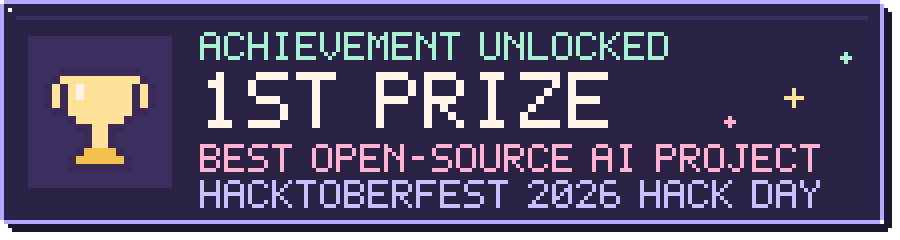
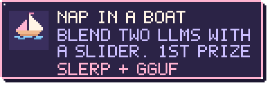
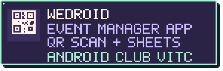
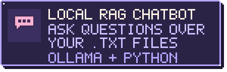
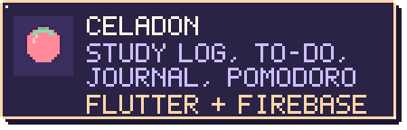
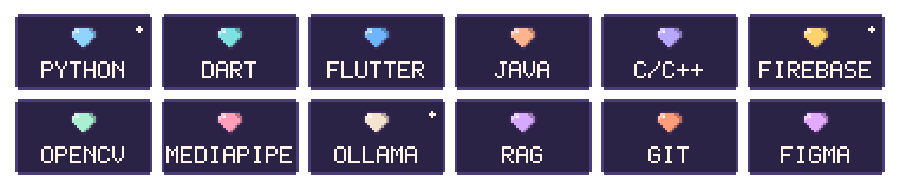
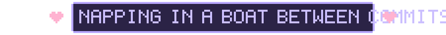

**2nd-year CS student &nbsp;·&nbsp; Flutter + Python &nbsp;·&nbsp; open-source AI**

 

## 🌙 hi, i'm vani

I'm a second-year B.Tech CSE student (Cyber-Physical Systems) at **VIT Chennai**. I like building things you can touch, drag and play with: apps in Flutter, tools in Python, and lately open-source AI.

- 🎓 B.Tech CSE, Cyber-Physical Systems, VIT Chennai (class of 2029)
- 📱 Tech and Design department, **Android Club VITC**
- 🤖 Into open-weight LLMs, RAG and computer vision
- 🌱 Flutter + Firebase for apps, Python for everything else

 

## 🏆 latest achievement

I won it with **[Nap in a Boat](https://github.com/Celaidon/Nap-in-a-boat)**, a team project where a slider blends a writing model and a coding model so you can watch the same prompt change from poetry to code. I owned the models and merging track: checking the pair was safe to merge, the SLERP merges, GGUF conversion and the model registry. The evaluation harness, backend and React app came from my teammates, Muskan Khushi and Sharva Rajesh Jadhav.

 

## 🎮 featured quests

  
  

  
  

- **WeDroid Event Manager**: I built a major part of the club's event app, the QR scanner that checks attendees in and the Google Sheets updates that record attendance live.
- **Celadon**: built in 48 hours for the Android Club recruitment challenge. [Try it](https://celadon-96aec.web.app/).

 

## 🎒 inventory

 

## 🗺️ side quests

- ✏️ **Vani's Canvas**: draw in the air with your webcam (OpenCV, MediaPipe, PyQt6)
- 🎙️ **JARVIS-inspired voice assistant**: offline desktop automation by voice, in Python
- 🚗 **Open-world driving game** that runs in the browser (Three.js)

 

Say hi if you're building something with open-source AI or Flutter.

All the pixel art is drawn from code: <a href="tools/build_assets.py"><code>tools/build_assets.py</code></a>

