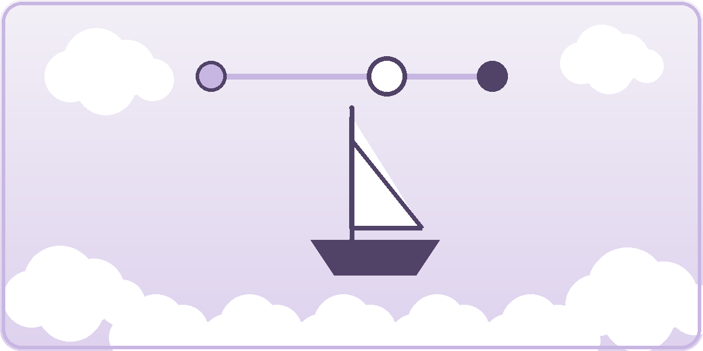
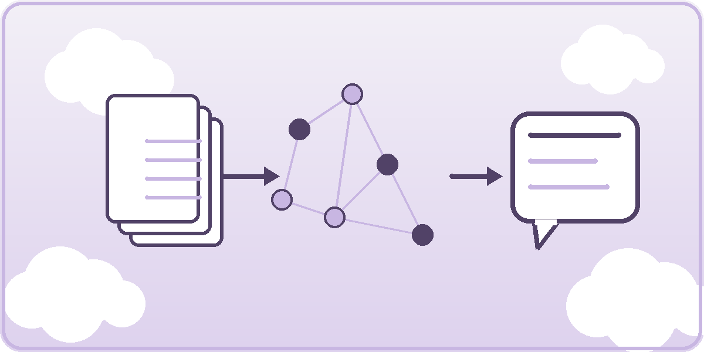
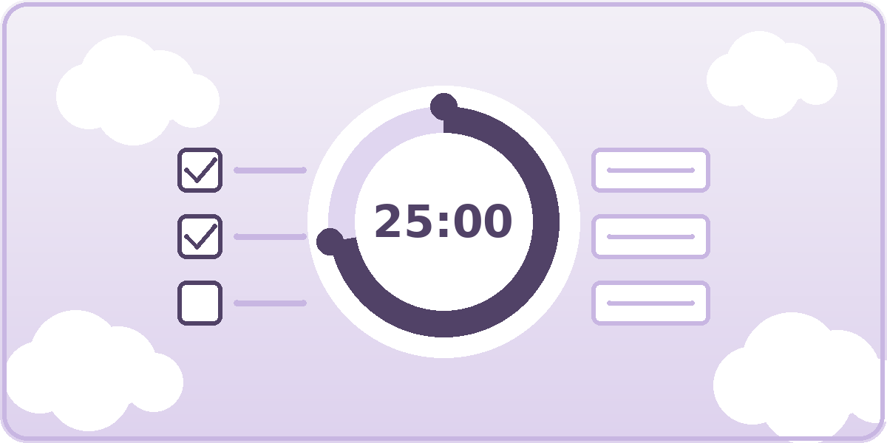
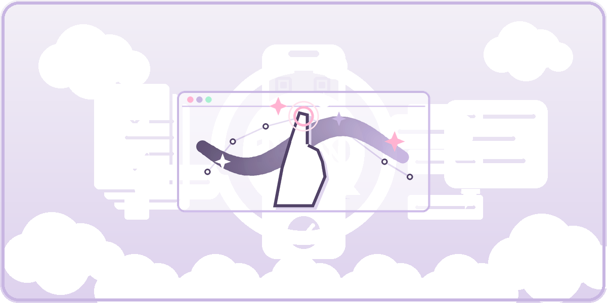
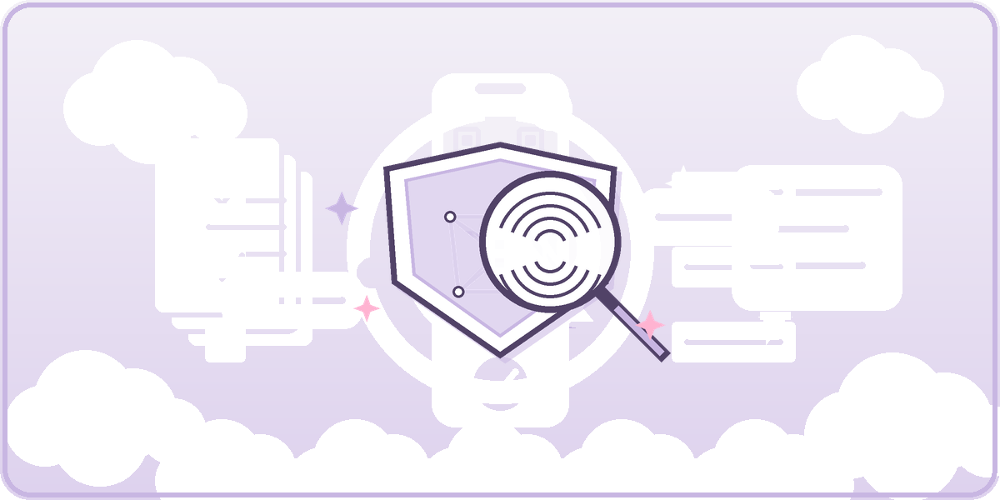
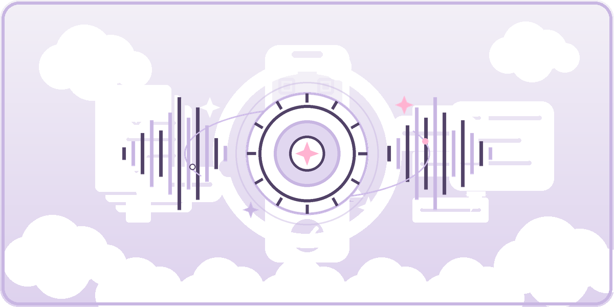

<!-- ============ INTRODUCTION ============ -->
<table align="center">
  <tr>
    <td valign="middle" align="right">
      <h1 align="right"><code>&nbsp;VANI MISHRA&nbsp;</code></h1>
      
<code>hi lol</code>

    </td>
    <td valign="middle" align="left">
      
    </td>
  </tr>
</table>

 

<!-- ============ TECH STACK ============ -->
<h2 align="center"><code>✦ &nbsp; tech stack &nbsp; ✦</code></h2>

  &nbsp;&nbsp;
  &nbsp;&nbsp;
  &nbsp;&nbsp;
  &nbsp;&nbsp;
  &nbsp;&nbsp;
  &nbsp;&nbsp;
  &nbsp;&nbsp;
  &nbsp;&nbsp;
  &nbsp;&nbsp;
  &nbsp;&nbsp;
  &nbsp;&nbsp;
  

<code>also: Ollama &middot; MediaPipe</code>

 

<!-- ============ PROJECTS ============ -->
<h2 align="center"><code>✦ &nbsp; projects &nbsp; ✦</code></h2>

<table align="center">
  <tr>
    <!-- Card 1 -->
    <td width="33%" valign="top" align="center">
      
        
      <a href="https://github.com/Celaidon/Nap-in-a-boat">
        <b><code>Nap in a Boat ↗</code></b>
      </a>
       
      Blend a writing model and a coding model with a single slider.
    </td>
    <!-- Card 2 -->
    <td width="33%" valign="top" align="center">
      
        
      <a href="https://github.com/Android-Club-VITC/WeDroid">
        <b><code>WeDroid Event Manager ↗</code></b>
      </a>
       
      Android Club's event app with QR check-in and live attendance.
    </td>
    <!-- Card 3 -->
    <td width="33%" valign="top" align="center">
      
        
      <a href="https://github.com/Celaidon/Retrieva">
        <b><code>Local RAG Chatbot ↗</code></b>
      </a>
       
      Answers questions over local text files using a local Ollama LLM.
    </td>
  </tr>
  <tr>
    <!-- Card 4 -->
    <td width="33%" valign="top" align="center">
      
        
      <a href="https://github.com/Celaidon/Celadon_study">
        <b><code>Celadon ↗</code></b>
      </a>
       
      Flutter productivity app with study log, to-do, journal and Pomodoro.
    </td>
    <!-- Card 5 -->
    <td width="33%" valign="top" align="center">
      
        
      <a href="https://github.com/Celaidon/Virtual-canvas">
        <b><code>Virtual Canvas ↗</code></b>
      </a>
       
      Draw in the air using hand gestures and webcam without mouse or touch.
    </td>
    <!-- Card 6 -->
    <td width="33%" valign="top" align="center">
      
        
      <a href="https://github.com/Celaidon/Forensys">
        <b><code>ForenSys ↗</code></b>
      </a>
       
      Digital crime scene evidence and investigation management system.
    </td>
  </tr>
  <tr>
    <!-- Card 7 -->
    <td width="33%" valign="top" align="center">
      
        
      <a href="https://github.com/Celaidon/desktop_pet">
        <b><code>Desktop Pet (Leon) ↗</code></b>
      </a>
       
      Interactive Leon S. Kennedy desktop companion in Python + PySide6.
    </td>
    <!-- Card 8 -->
    <td width="33%" valign="top" align="center">
      
        
      <a href="https://github.com/Celaidon/Jarvis">
        <b><code>JARVIS ↗</code></b>
      </a>
       
      Desktop AI voice assistant for offline desktop automation.
    </td>
    <!-- Card 9 (Empty balance cell) -->
    <td width="33%" valign="top" align="center">
    </td>
  </tr>
</table>
